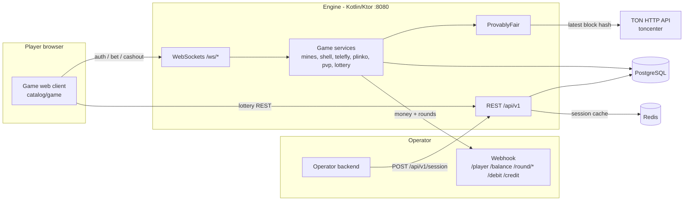

<h1 align="center">Provably Fair Casino Games</h1>

<p align="center">
  Self-hosted provably fair casino games - Mines, Crash, Plinko, Lottery and more - verifiable on the TON blockchain.
</p>

<p align="center">
  <a href="LICENSE"></a>
  
  <a href="https://github.com/nekzabirov/Provably-Fair-Casino-Games/actions/workflows/ci.yml"></a>
</p>

---

## Why

Most casino games are black boxes: the player has to trust that the house did not pick
the outcome after seeing the bet. This project is a complete game provider you can run
yourself, where every round can be checked. Each outcome is derived from a server seed
that is committed before play, a public TON blockchain block hash that nobody controls,
and - in single-player games - a seed chosen by the player. After the round the server
seed is revealed and anyone can recompute the result.

It plugs into an existing casino (an "operator") the way third-party game providers do:
the operator registers player sessions over REST and implements one webhook for player
info and money movement. The engine never holds balances.

## Features

- **Six games**, each with a ready-to-deploy web client:
  Mines, Lucky Cups (three-cup shell game), TeleFly (crash), Plinko, PvP jackpot wheel,
  and Lottery 6/49.
- **Provably fair** by construction: HMAC-SHA256 over a committed server seed, a TON
  masterchain block hash and the player's seed; every client ships an in-app verifier.
- **Operator integration** through a small REST API (`X-Operator` / `X-Secret-Key`) and
  a single webhook (`/player`, `/balance`, `/round/open`, `/round/close`, `/debit`,
  `/credit`).
- **Real-time play** over WebSockets, including always-on shared rounds (crash, PvP
  wheel) broadcast to every connected player.
- **Safe money flow**: every debit and credit is recorded before the webhook call and
  carries a stable `transactionId`, so retries can be deduplicated by the operator.
- **Multi-operator**: any number of brands on one engine; the lottery pot is shared
  across all of them.
- **Self-contained**: Kotlin + Ktor, PostgreSQL, Redis, one `docker compose up`.

## Architecture



The operator mints a session token and registers it with `POST /api/v1/session`; the
engine asks the operator's `/player` webhook who the token belongs to. The player's
browser opens a game client with that token and plays over a WebSocket. Every stake and
payout is executed by the operator through the webhook; the engine keeps a ledger of
rounds and transactions in PostgreSQL. More in the
[Architecture](https://github.com/nekzabirov/Provably-Fair-Casino-Games/wiki/Architecture) wiki page.

## Quick start

Requirements: Docker with Compose, and internet access from the engine container (it
reads TON block hashes from `https://toncenter.com/api/v2` by default).

```bash
git clone https://github.com/nekzabirov/Provably-Fair-Casino-Games.git
cd Provably-Fair-Casino-Games
docker compose up --build
```

This builds and starts PostgreSQL, Redis, the engine (`:8080`), the example operator
(`:9090`, an in-memory wallet) and the six web clients. A one-shot `brand-seed` service
registers the demo operator (`demo-operator` / `demo-secret`).

Create a session for player `42` through the example operator:

```bash
curl -X POST http://localhost:9090/session/42
# {"token":"...","expireAt":"..."}
```

Open a game with that token:

| Game         | URL                                                                              |
|--------------|----------------------------------------------------------------------------------|
| Mines        | `http://localhost:8082/?sessionToken=<token>&currency=TON&operator=demo-operator` |
| Lucky Cups   | `http://localhost:8083/?sessionToken=<token>&currency=TON&operator=demo-operator` |
| TeleFly      | `http://localhost:8084/?sessionToken=<token>&currency=TON&operator=demo-operator` |
| Plinko       | `http://localhost:8085/?sessionToken=<token>&currency=TON&operator=demo-operator` |
| PvP wheel    | `http://localhost:8086/?sessionToken=<token>&currency=TON&operator=demo-operator` |
| Lottery 6/49 | `http://localhost:8087/?sessionToken=<token>&currency=TON&operator=demo-operator` |

The demo player starts with 1000 TON. See
[Getting Started](https://github.com/nekzabirov/Provably-Fair-Casino-Games/wiki/Getting-Started)
for running without Docker.

## Configuration

The engine reads environment variables (`src/util/Env.kt`, `resources/logback.xml`).
All have defaults suitable for local development.

| Variable | Default | Description |
|---|---|---|
| `SERVER_PORT` | `8080` | HTTP/WebSocket port. |
| `DB_URL` | `jdbc:postgresql://localhost:5432/gameengine` | PostgreSQL JDBC URL. The schema is created at startup. |
| `DB_USER` | `postgres` | Database user. |
| `DB_PASSWORD` | `postgres` | Database password. |
| `DB_POOL_SIZE` | `10` | HikariCP maximum pool size. |
| `REDIS_URL` | `redis://localhost:6379` | Redis URL (session cache). |
| `TON_API_URL` | `https://toncenter.com/api/v2` | TON HTTP API base; `GET {url}/getMasterchainInfo` supplies the public seed. |
| `TON_BLOCK_CACHE_SECONDS` | `5` | How long a fetched TON block hash is reused. |
| `SESSION_EXPIRE_MINUTES` | `1440` | Session lifetime. |
| `BRAND_TIMEOUT_MS` | `5000` | Timeout of each operator webhook call. |
| `TELEFLY_TICK_MS` | `100` | TeleFly multiplier broadcast interval. |
| `TELEFLY_BETTING_MS` | `10000` | TeleFly betting window. |
| `TELEFLY_CRASH_PAUSE_MS` | `4000` | Pause after a crash before the next round. |
| `TELEFLY_SEND_TIMEOUT_MS` | `1000` | Per-connection send timeout for TeleFly broadcasts. |
| `TELEFLY_GROWTH_RATE` | `0.07` | Multiplier curve `exp(rate * seconds)`. |
| `PVP_TICK_MS` | `100` | PvP loop interval. |
| `PVP_COUNTDOWN_MS` | `10000` | Countdown once enough players have bet. |
| `PVP_SPIN_MS` | `6000` | Wheel spin duration. |
| `PVP_PAYOUT_PAUSE_MS` | `4000` | Pause showing the winner. |
| `PVP_SEND_TIMEOUT_MS` | `1000` | Per-connection send timeout for PvP broadcasts. |
| `PVP_MIN_PLAYERS` | `2` | Players needed to start the countdown. |
| `LOTTERY_CURRENCY` | `TON` | Lottery currency. |
| `LOTTERY_TICKET_PRICE_NANO` | `10000000000` | Base ticket price (6 numbers), nanoton; n numbers cost base x (n - 5)^2. |
| `LOTTERY_BASE_POOL_NANO` | `1000000000000` | Guaranteed starting pool (1000 TON), nanoton. |
| `LOTTERY_COMMISSION_PERCENT` | `10` | Commission taken from a pool that has a winner. |
| `LOTTERY_NUMBERS` | `6` | Numbers drawn (and minimum picks per ticket). |
| `LOTTERY_MAX_PICKS` | `36` | Maximum picks on one system ticket. |
| `LOTTERY_RANGE` | `49` | Numbers are drawn from `1..RANGE`. |
| `LOTTERY_MAX_TICKETS_PER_PLAYER` | `1` | Tickets per player per draw. |
| `LOTTERY_TICK_MS` | `1000` | Lottery loop interval. |
| `LOTTERY_DRAW_INTERVAL_MS` | `10000` | Delay between revealing drawn numbers. |
| `LOTTERY_SETTLE_PAUSE_MS` | `10000` | Pause on the result before the next draw. |
| `LOTTERY_SEND_TIMEOUT_MS` | `1000` | Per-connection send timeout for lottery pushes. |
| `LOTTERY_ROUND_MS` | `7200000` | Draw length (2 h), aligned to UTC boundaries. |
| `LOG_LEVEL` | `INFO` | Root log level (JSON logs to stdout). |
| `OPERATOR` | `aggregator` | Value of the `env` field in every log line. |

Web clients read build-time variables (`VITE_WS_URL`, `VITE_API_BASE`,
`VITE_AVATAR_PROXY_URL`) and the example operator has its own settings; see
[Configuration](https://github.com/nekzabirov/Provably-Fair-Casino-Games/wiki/Configuration).

## API overview

| Surface | Endpoint | Auth | Purpose |
|---|---|---|---|
| REST | `GET /api/v1/games` | `X-Operator` + `X-Secret-Key` | List game identities. |
| REST | `POST /api/v1/session` | `X-Operator` + `X-Secret-Key` | Register or extend a player session (`{"token": "..."}`). |
| REST | `POST /api/v1/lottery/state`, `POST /api/v1/lottery/buy` | session token in body | Lottery client: current draw, buy a ticket. |
| REST | `GET /api/v1/avatar?u=<url>` | none | CORS proxy for Telegram avatar images (PvP wheel). |
| WebSocket | `/ws/mines`, `/ws/shell`, `/ws/telefly`, `/ws/plinko`, `/ws/pvp`, `/ws/lottery` | `auth` frame with session token | Gameplay. |
| WebSocket | `/ws/jackpot` | none | Public live lottery jackpot feed. |
| Webhook (engine to operator) | `POST {webhookUrl}/player`, `/balance`, `/round/open`, `/round/close`, `/debit`, `/credit` | `X-Secret-Key` | Player info and money movement. |

There is no gRPC interface. Full reference:
[API](https://github.com/nekzabirov/Provably-Fair-Casino-Games/wiki/API) and
[Operator Integration](https://github.com/nekzabirov/Provably-Fair-Casino-Games/wiki/Operator-Integration).

## Project structure

```
src/                     engine (Kotlin; Gradle source root)
  Application.kt         server bootstrap, schema creation, route registration
  AppModule.kt           Koin wiring
  api/                   operator REST API, lottery REST API, avatar proxy, game catalog
  adapter/               operator webhook client, Redis cache, TON block-hash client
  service/               sessions/players, rounds and money, provably fair
  model/                 shared entities: brand, player, session, round, transaction
  game/<game>/           command/ model/ network/ service/ per game
  util/                  Env, value objects (Amount, Currency, Identity), helpers
resources/logback.xml    JSON logging
catalog/<game>/          Vue 3 + Vite web client per game (lottery, lucky, mines, plinko, pvp, telefly)
example/operator/        reference operator with an in-memory wallet (separate Gradle project)
docs/                    operator and lottery integration guides; docs/wiki/ = GitHub Wiki source
```

## Development

```bash
# engine (JDK 21); needs PostgreSQL and Redis for ./gradlew run
./gradlew build installDist
./gradlew run

# example operator
./gradlew -p example/operator build installDist

# a web client (Node 22); `npm run dev` proxies the engine on :8080
cd catalog/mines && npm ci && npm run type-check && npm run build
```

The engine has no automated test suite yet. See
[Development](https://github.com/nekzabirov/Provably-Fair-Casino-Games/wiki/Development).

## Documentation

The full documentation lives in the
[Wiki](https://github.com/nekzabirov/Provably-Fair-Casino-Games/wiki): Getting Started,
Configuration, Architecture, API, Games, Provably Fair, Operator Integration,
Web Clients, Deployment and Development.

## Contributing

Contributions are welcome - see [CONTRIBUTING.md](CONTRIBUTING.md).

**Documentation rule.** Every change that affects behaviour, configuration, API, build or
deployment MUST update `README.md` and the relevant pages in `docs/wiki/` in the same
commit / pull request. A change is not done until the docs match the code.

## License

Apache License 2.0 - see [LICENSE](LICENSE). Bundled fonts and the TeleFly engine sound
are third-party assets under their own licenses; see [NOTICE](NOTICE).

---

Used in production at [1638.cloud](https://1638.cloud).
