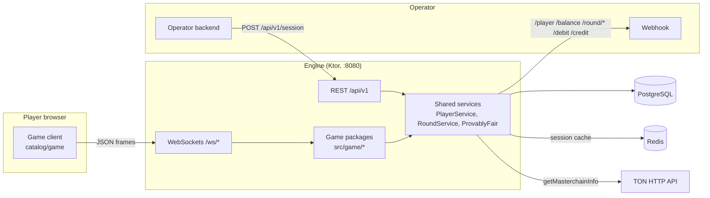

# Architecture

## Components



| Part | Where | Role |
|---|---|---|
| Engine | `src/` | Ktor (CIO) server: REST, WebSockets, game logic, ledger. |
| Web clients | `catalog/<game>/` | Vue 3 + Vite single-page apps, one per game. |
| Example operator | `example/operator/` | Minimal casino backend with an in-memory wallet, for local testing. |
| PostgreSQL | - | Brands, players, sessions, rounds, transactions, per-game state. |
| Redis | - | Cache of `session:<token>` lookups. |
| TON HTTP API | toncenter by default | Source of the public seed (latest masterchain block hash). |

The engine is a single Gradle module (`ton-game`). `Application.kt` connects to the
database, creates and migrates the schema, installs Koin (`AppModule.kt`), content
negotiation and WebSockets (25 s ping, 60 s timeout), registers every route and socket,
and starts the three always-on loops (TeleFly, PvP, Lottery).

## Code layout

```
src/
  Application.kt, AppModule.kt
  api/        OperatorApi (/api/v1/games, /api/v1/session), LotteryApi, AvatarApi, GameCatalog
  adapter/    BrandAdapter (webhook client), CacheAdapter (Redis), TonAdapter (block hash)
  service/    BrandService, PlayerService, RoundService, ProvablyFair
  model/      Brand, Player, Session, Round, Transaction (Exposed table + entity per file)
  exception/  sealed GameException hierarchy
  game/<game>/
    command/  one handler per WebSocket command (auth, start, bet, cashout, ...)
    model/    the game's entity and its state/frames sent to clients
    network/  socket route, connection registry, command bus, envelope parsing
    service/  pure math (outcome from hash) and, for shared games, the round engine
  util/       Env, Amount, Currency, Identity, sha256/hex, runTransactionCatching
```

Conventions: services and adapters are concrete classes (no interfaces) wired by Koin;
persistence uses Exposed DAO; money is `Amount` (Long minor units); time is
`kotlinx.datetime.Instant`. See `AGENTS.md` in the repository.

## Flows

### Session

1. The operator mints a token and calls `POST /api/v1/session` with `X-Operator` and
   `X-Secret-Key`.
2. The engine calls the operator's `/player` webhook with the token, upserts the player
   (by operator player id + brand) and stores the session with its expiry.
3. The game client authenticates its socket with `auth {token, operator}`. The engine
   resolves the session (cached in Redis under `session:<token>`) and checks that it
   belongs to that operator.

### Single-player round (Mines, Lucky Cups)

1. `start` opens a round (`/round/open`) and debits the stake (`/debit`), then stores
   the game with a fresh server seed, the player's seed (from `auth`) and the current
   TON block hash. The state sent back carries the SHA-256 of the server seed.
2. Moves (`open` a cell, `pick` a cup) evaluate the outcome hash.
3. The round ends with a credit (`/credit`) on a win or cash-out, then `/round/close`;
   the server seed is revealed in the final state.

Plinko is a single command: each `drop` debits, resolves and credits at once.

### Shared rounds (TeleFly, PvP, Lottery)

One coroutine per game runs forever on the application scope. It prepares the next
round's seeds, broadcasts phases to every connected socket and settles every bettor.
State is held in memory behind a mutex that is never held across an operator HTTP call:
lock, validate and claim in memory, unlock, move money, lock again to finalise. Each
bettor still gets their own `Round` and `Transaction` rows, so the operator sees the
same webhooks as for single-player games. On startup TeleFly and PvP reconcile rounds
left open by a previous process. The lottery draw is persisted (`lotteries`,
`lottery_tickets`) and resumes after a restart.

Because these loops live in the process, run exactly one engine instance (see
[Deployment](Deployment)).

## Money and the ledger

The engine never holds balances; the operator moves money when the engine calls
`/debit` and `/credit`. `RoundService` records every movement in `transactions` using a
PENDING-first pattern:

1. Insert the transaction (`DEBIT` or `CREDIT`, status `PENDING`) and commit.
2. Call the webhook with that row's id as `transactionId`.
3. Mark it `CONFIRMED`. A rejected debit is marked `ABORTED`; a failed credit stays
   `PENDING` and a retry re-sends the same `transactionId`, so the operator can
   deduplicate instead of paying twice.

If game work fails after a confirmed debit, the engine refunds it with a fresh credit,
marks the debit `ABORTED` and closes the round (`compensateDebit`).

## Data model

Tables are created by `SchemaUtils.create` at startup; a few idempotent `ALTER`/`CREATE
INDEX` statements in `Application.kt` migrate older databases.

| Table | Contents |
|---|---|
| `brands` | operator `identity` (unique), `secret`, `webhook_url` |
| `players` | operator player id, brand, username, avatar |
| `sessions` | operator-minted `token` (unique), player, created/expiry time |
| `rounds` | game identity, player, currency, opened/closed time |
| `transactions` | type, status, amount, round, created time |
| `mines_games`, `shell_games`, `plinko_games`, `telefly_games`, `pvp_games` | per-round game state and provably fair seeds |
| `lotteries`, `lottery_tickets` | draws and tickets |

A partial unique index `uniq_active_round` on `rounds (player_id, game, currency) WHERE
closed_at IS NULL AND game <> 'lottery'` guarantees one open round per player, game and
currency.

## Provably fair

`ProvablyFair` generates 32-byte server seeds, publishes their SHA-256, fetches the TON
seed through `TonAdapter` (cached `TON_BLOCK_CACHE_SECONDS`) and computes HMAC-SHA256
outcome hashes. Each game's pure math turns the hash into an outcome. Full algorithm:
[Provably Fair](Provably-Fair).
